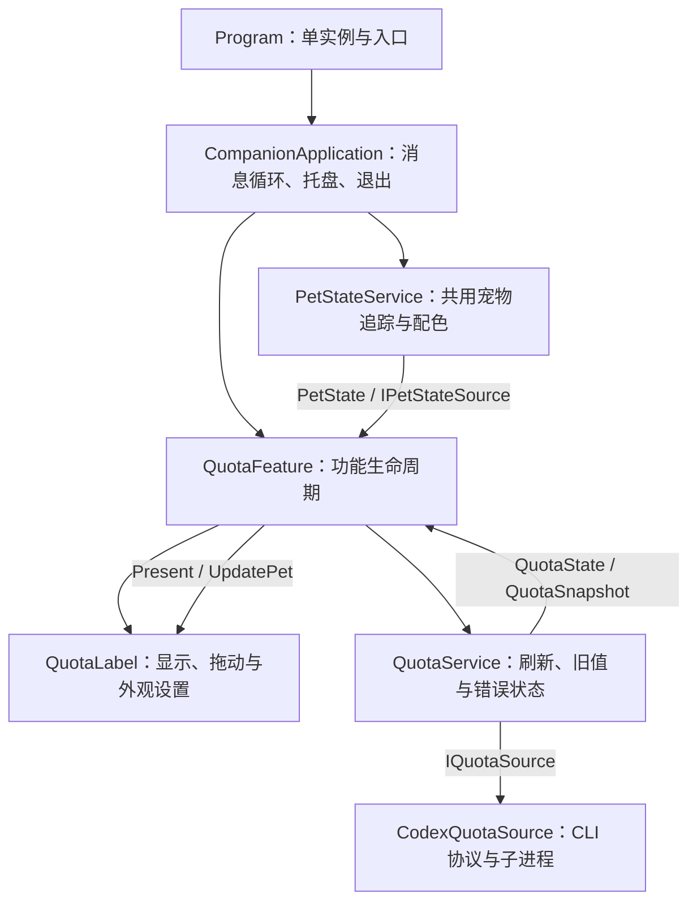

# 架构与扩展约定

PetFolio 的长期方向是围绕 Codex Pet 提供实用功能与互动。Quota Bubble 是第一个功能模块。当前采用单进程内的显式模块注册，先维持清晰边界，再根据第二个实际功能决定进一步抽象。

## 运行结构

`Application.Run` 运行宿主的 `ApplicationContext`。任何单个功能窗口都不是主窗口；停用额度功能后，托盘、消息循环和共用宠物服务继续运行。

## 职责与所有权

| 层 | 负责 | 不应引入的依赖 |
| --- | --- | --- |
| 宿主 | 注册功能、托盘、功能开关、单实例恢复信号、退出、UI 回呼调度 | 额度解析与绘制细节 |
| 宠物服务 | 唯一一份窗口发现、元数据轮询、鼠标观察、位置校正和配色 | 具体功能窗口、额度状态 |
| 额度功能 | 创建与释放自己的视窗、服务、订阅和菜单命令 | 宠物配置键或窗口识别规则 |
| 额度服务 | 五分钟刷新、并发请求合并、失败保留旧值、发布类型化状态 | 具体窗口及 CLI 协议 |
| CLI 来源 | stdio 握手、响应处理、超时、子进程终止 | UI、托盘、显示文案 |
| 额度视窗 | 内容显示、面板拖动、吸附、透明度、隐藏与恢复 | 查询子进程、宠物发现、应用退出 |

`PetState`、`QuotaSnapshot`、`QuotaState` 是只读快照。额外的额度提醒或消耗分析应使用额度模型，不应解析视窗文字。解析后的额度保留窗口时长与重置时间，积分余额不参与剩余额度计算。

所有生命周期操作、事件订阅和视窗更新在 UI 线程进行。后台查询与取色通过宿主持有的调度窗口回到 UI 线程；它们不依赖额度窗口是否可见。释放服务后，已排队的旧结果也不得发布到新实例。

玻璃视窗共用 UI 线程的 Composition dispatcher controller，各自释放自己的合成树、背景源、阴影和窗口。共享 controller 保留至线程／进程退出，避免反复启停或多个面板并存时重复创建。

## 三种不同操作

- **隐藏**：点击 ×；窗口、玻璃与阴影隐藏，额度仍继续刷新，托盘命令可恢复同一视窗。
- **停用内容**：托盘 `Features → Quota remaining / System usage` 独立控制两个模式。停用额度释放 QuotaService，停用 System 停止采样。共享视图保留；两项都关闭时隐藏视图并禁用 Show Bubble / Refresh。重新启用额度创建服务并立即查询。
- **退出应用**：托盘 `Exit` 或 `--stop`；释放所有功能、共用追踪器、鼠标 hook、托盘及调度资源。

`appearance.json` 保存 `quotaEnabled`、`systemEnabled` 与 `bubbleMode`；旧设置缺少开关时默认两项启用。重复启动只恢复已启用内容的气泡，不覆盖功能开关。`ICompanionFeature.FeatureOptions` 由模块持有并同步勾选，宿主负责放入 Features 菜单。只有两项都启用才提供切换；关闭当前模式切换到另一个已启用模式。Refresh 与单击使用同一入口，刷新当前模式的数据和字体颜色。

System Bubble 是同一视图的第二种显示模式，未注册第二个 feature 或创建第二个气泡。`QuotaLabel` 保存 `bubbleMode`，通过双击或托盘切换，保留额度快照；单击延迟到系统双击判定时间之后，防止切换触发额度查询。系统模式可见时每两秒读取 `SystemMetricsSource`：CPU 使用 `GetSystemTimes` 差分（kernel 包含 idle），内存使用 `GlobalMemoryStatusEx`，网络按介面 ID 对字节计数和单调时间作差。隐藏、切回额度或销毁视图时停止系统计时器并清空采样基线；额度只在 Quota remaining 启用期间保持轮询。新介面或计数器复位不会产生速率尖峰。

## 外观策略

托盘菜单由 `TrayMenuStyle` 统一展示：使用 Windows `SystemFonts.MenuFont`，主菜单及子菜单采用 8px 圆角、4px 内边距和 28px 行高（按 DPI 缩放），统一文字、勾选和子菜单箭头列。样式复用原有 ToolStrip 项目，不修改命令、启用状态或事件处理。

菜单颜色跟随 Codex home 下 `config.toml` 的 `appearanceTheme`：dark / light 优先于系统，system 或缺省时读取 Windows 应用主题。打开菜单立即检查，并每两秒同步所有已创建子菜单；读取失败保留上次主题。深浅色分别设置底色、文字、禁用项、分隔线、勾选、箭头及悬停色，不影响气泡的外观选择。

托盘根菜单打开时，宿主通知气泡暂停悬停关闭按钮、窗口跟随和桌面取色，保留最新宠物状态及数据刷新。避免关闭按钮窗口 Show 触发 ToolStrip 的 AppFocusChange，或气泡重新置顶遮住菜单。根菜单关闭后通过 UI 队列恢复，确保所有子菜单已退出；`TrayOverlapTests` 使用真实菜单与层叠气泡重复验证重叠、子菜单及恢复行为。

外观与内容模式独立：`appearanceMode` 保存 `default / pet`，缺省为 Default。`BubbleAppearance` 保存客户端 26.1007 的浅色 `#ffffffe6` / 深色 `#202020e6`、文字与描边令牌；固定 alpha 230，使用中性灰进度条和内侧高光。Default 是半透明底色，不模糊桌面；GlassBackdrop 将 Gaussian 背景层的 Opacity 设为 0，切回 Pet colour 恢复为 1。Default 不使用桌面采样或宠物颜色，不显示旧模式的外阴影。通过 Windows 设置/主题消息及两秒补偿检查读取 `AppsUseLightTheme`，读取失败保留现有主题。Pet colour 保留毛玻璃、`opacityPercent` 和低透明度黑白字适配；切换外观会清除旧桌面样本。外观计时器随视图释放，Pet colour 下停止。`BubbleMaterialTests` 用真实合成窗口上黑白条纹的像素对比验证材质切换。

## 添加下一个功能

`Appearance → Frosted glass` 独立控制背景模糊。`defaultFrostedGlass` 与 `petFrostedGlass` 保存各外观的选择，旧设置缺省为 false / true。开关直接修改背景模糊层的 Opacity，不改变底色、字体、透明度限制或外阴影规则。

1. 实现 `ICompanionFeature`，提供 `Start`、`Stop`、`Restore`、`Dispose` 和菜单命令。
2. 在宿主构造阶段显式创建并 `Register`。需要宠物状态时注入现有 `IPetStateSource`，不要再建立一份宠物轮询或鼠标 hook。
3. `Start` 应可重复调用且不重复订阅；`Stop` 应可重复调用并完整释放功能资源；停止后允许重新启动，最终 `Dispose` 后不再启动。
4. 菜单命令及 FeatureOptions 由模块拥有。内容开关独立于模块生命周期；模块 Stop 释放视图命令，Dispose 释放功能选项。宿主只负责把命令加入托盘。
5. 对跨模块边界增加行为测试：停用一个功能不能影响另一个功能，旧异步结果不能污染重启后的实例。

如果未来多个独立模块都需要额度数据，再将 `QuotaService` 提升为宿主共用服务；目前由额度功能拥有，停用即可停止查询。

## 当前边界

- 本次建立的是进程内功能边界，尚无动态加载、第三方插件 SDK 或进程级故障隔离。
- 多面板占位协调尚未实现；现有定位算法仍针对单个面板。第二个实际面板确定后再设计布局协调。
- 玻璃与阴影仍采用现有额度面板的尺寸与圆角；它们不是任意尺寸的通用组件。
- Codex 客户端内部配置键、窗口类名和进程识别集中于宠物服务及其配色辅助组件，仍需跟随客户端版本维护。
- CLI 登录账号与桌面账号的一致性、混合 DPI 多显示器行为仍需现场验证。

## 验证

`test.ps1` 覆盖配色、切换、跟随、位置、额度模型与服务、真实 stdio 假服务器、功能启停与共存。假服务器不读取账号、不访问网络；测试不会查询真实额度。

`build-glass-verification.ps1` 与 `GlassVerification.exe` 验证真实 Windows 玻璃、鼠标命中、关闭／恢复和背景更新。支持 `-OutputDirectory .test-build` 在隔离目录生成程序与截图。

单独验证生产构建可执行 `./build.ps1 -OutputDirectory .test-build`，无需覆盖正在运行的程序。

## Codex 插件封装

`plugins/petfolio` 提供根目录插件清单、旧版兼容清单、操作 skill 与管理脚本。`package-plugin.ps1` 将它们和预编译 Windows x64 程序打包，并生成独立本机 marketplace。脚本通过 `--status`、`--check` 和 `--stop` 管理进程；启动时等待初始化完成的会话信号，重复启动恢复现有实例。安装本身不会启动程序。

`RuntimeData` 统一解析 `%LOCALAPPDATA%\PetFolio` 或绝对 `PETFOLIO_DATA_DIR`，并从程序目录迁移旧偏好与配色元数据。插件缓存只有程序与资源；用户资料不随插件更新或卸载删除。`Program.Folder` 仍用于独立视觉验证产物，业务设置及缓存使用 `Program.DataFolder`。

`test-plugin.ps1` 验证 Windows PowerShell 5.1、中文与空格路径、缓存搬迁，以及隔离 Codex 安装／卸载。可选 `-TestLaunch` 使用假 CLI 验证实际宿主启停。当前没有 MCP 控制界面或生命周期 hooks；客户端内部宠物跟踪仍需现场兼容性测试。

正式气泡布局由 `BubbleLayout` 统一 208×104 尺寸和 25px 圆角，供前景、玻璃裁剪、阴影与命中区域使用。双列 x=20/114、进度条宽 74px，底部信息固定在 (20,82)：Quota 显示更新时间，System 使用 `SystemMetrics.Rate` 并列显示完整单位的上下行网速，不显示更新时间或单位悬停提示；超宽时只舍入数值，保留完整单位。Pet colour 辅助文字 alpha 固定为 204（80%）；Default 使用原生主次文字色。进度条使用数值快照，缺失值仅画轨道；配色 alpha 独立于玻璃透明度，按合成背景调整可见对比度。

Pet colour 的 System 模式在背景不透明度为 10% 或 20% 时随指标刷新重新采样桌面，使黑白字体不依赖五分钟额度刷新。隐藏时不采样，采样失败保留上次背景；常规透明度不增加系统刷新取样。
