# PetFolio

[繁體中文](#petfolio) · [English](#english)

**圍繞 Codex Pet，增加實用功能與互動的 Windows 桌面伴侶工具。**

PetFolio 讓桌面寵物成為工作時有用的小夥伴。**Quota remaining** 顯示剩餘額度，**System Usage** 顯示 CPU、記憶體使用率與網速。兩項功能共用你已有的 Codex Pet 旁的氣泡，跟隨寵物移動，並提供單擊刷新、雙擊切換與外觀調整。

可擴充性是專案的基本要求：應用宿主、共用寵物狀態與個別功能已分開，後續功能可以沿用同一套追蹤與生命週期管理。

> 提供獨立 Windows 程式及可安裝的本機 Codex 插件封裝。應用程式名稱為 PetFolio，包含 Quota remaining 與 System Usage 兩項功能；插件入口提供啟動、停止與診斷。尚未公開上架。

[下載最新版本](https://github.com/tenntsitinn/PetFolio/releases/latest) · [快速開始](#快速開始) · [使用方式](#使用方式) · [開發與擴充](#開發與擴充) · [已知限制](#已知限制)

> **Frosted glass 正在進行灰測。** 可在系統匣 `Appearance → Frosted glass` 啟用或停用背景模糊；Default 禁用毛玻璃；Pet colour 預設開啟並保存選擇。歡迎回報顯示異常或效能問題。

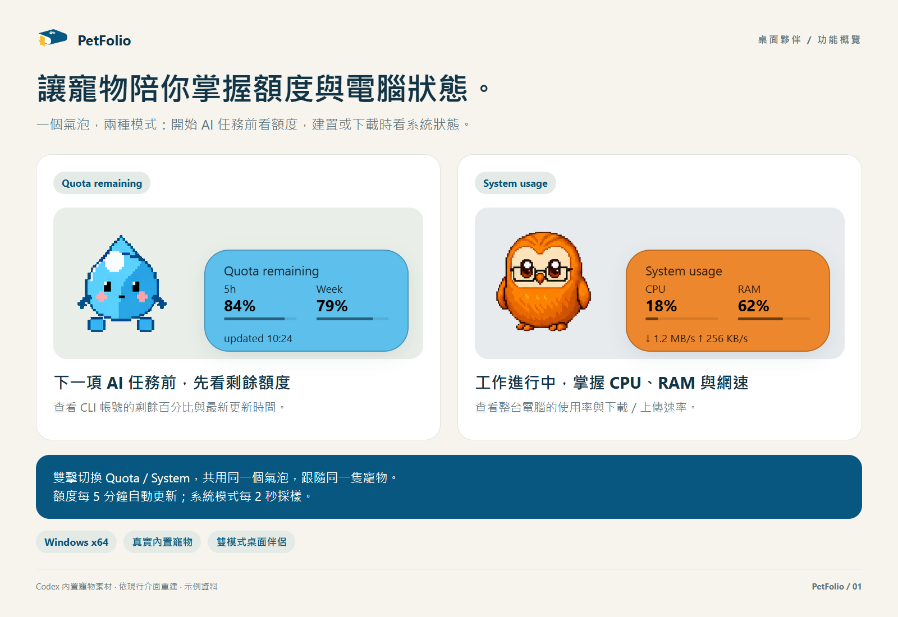

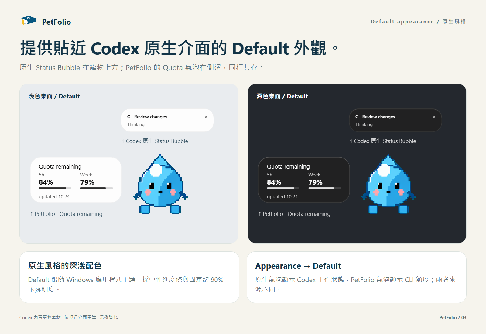

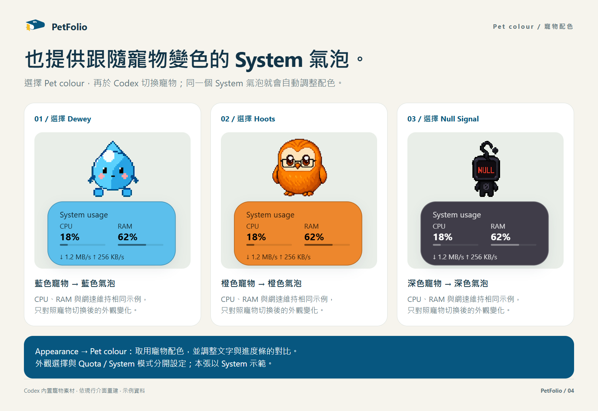

介面示意採用 Codex 內置寵物與示例數值。

<details>
<summary>操作與設定圖解（展開）</summary>

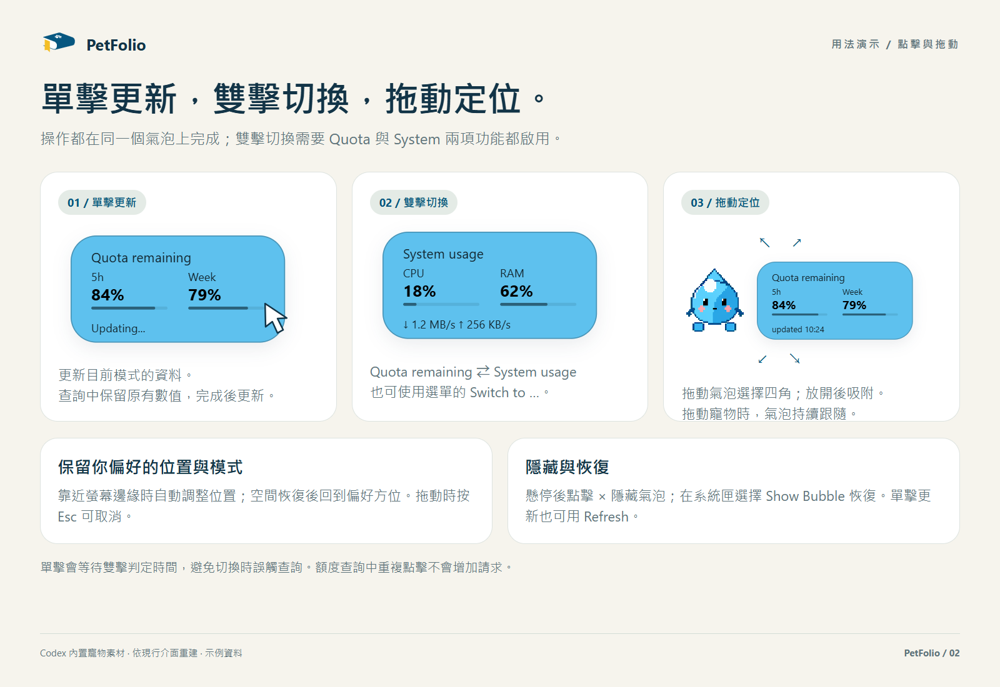

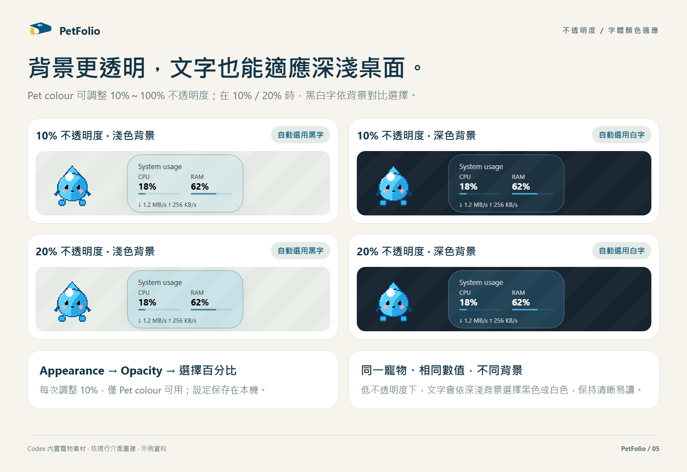

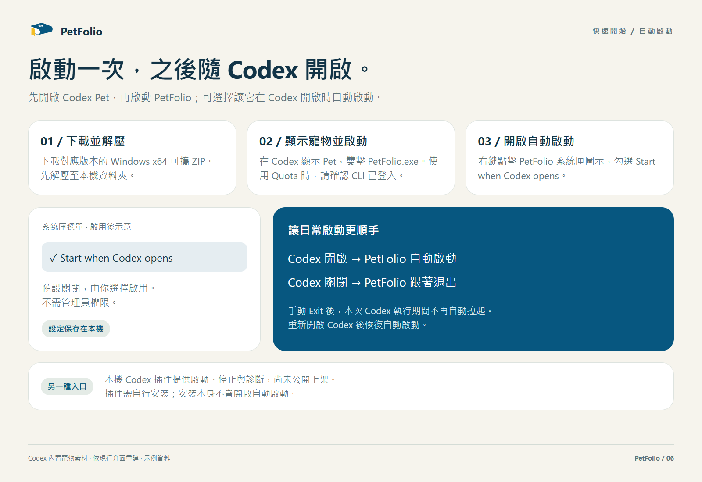

</details>

## 目前功能：Quota remaining 與 System Usage

兩種模式共用 **208 × 104 px** 氣泡，標題為 **Quota remaining / System usage**。雙列指標使用 16px 粗體，標題 13px、輔助資訊 11px（Segoe UI）。進度條分別表示剩餘額度或 CPU／RAM 使用率；Default 使用中性灰進度條，Pet colour 使用寵物主題色並修正對比度；填充與軌道約 85%／15% alpha。System 底部並列顯示完整網速，例如 `↓ 1.2 MB/s  ↑ 256 KB/s`，不顯示更新時間；Quota 底部保留 `updated`。

- **System Usage**：雙擊同一個氣泡，在額度與系統監控之間切換；也可使用系統匣的 **Switch to System usage / Switch to Quota remaining**。模式會保存，下次啟動自動恢復。系統模式每兩秒顯示整機 CPU 使用率、實體記憶體使用率，以及網路下載（↓）與上傳（↑）速率；單擊可刷新當前模式，拖動與關閉操作保持一致。
- 系統模式沿用原有視窗、大小、配色與定位，不新增氣泡。隱藏或回到額度模式時停止系統採樣；額度仍依原有週期在背景更新。CPU 與網速首次採樣顯示 `--`，下一次採樣才有速率。網速合計啟用中的非 loopback、非 tunnel 介面；VPN 或虛擬網卡可能造成重複計算，數值不是 Codex 專屬流量。單擊會等待系統雙擊判定時間，避免切換模式時觸發額度查詢。

- **Quota remaining**：透過 Codex CLI 的 `account/rateLimits/read` 查詢，以回傳的計算週期顯示剩餘百分比；充值積分不混入訂閱額度。
- **自動與手動刷新**：啟用時立即查詢，之後每五分鐘刷新；單擊氣泡可立即更新。查詢中保留已有數值，失敗時保留最近一次結果並標示更新失敗。
- **跟隨與定位**：拖動寵物時氣泡持續跟隨，以寵物畫布中心與目前螢幕工作區中心比較：寵物在左半區時氣泡放右側，到達右半區時改放左側，垂直居中於寵物畫布。靜止重新佈局時優先保留已有側，空間不足時依溢出代價避讓，最後限制在工作區內。拖動氣泡仍可手動選側；再次拖動寵物會重新按中線選側。舊的上下方位設定會沿用原本的左右側作為初始方向。
- **配色與玻璃背景**：Default 使用原生氣泡配色；Pet colour 配色優先使用寵物源圖快取，無有效快取時嘗試從寵物視窗取色。兩種外觀支援圓角並共用原生 Status Bubble 陰影，陰影深淺隨 Codex 主題同步；Pet colour 提供 0%～100%（步進 1%） 背景不透明度；玻璃初始化失敗時回退為半透明背景。
- **減少操作干擾**：氣泡不搶走編輯器焦點，透明圓角及背景、陰影區域可讓滑鼠穿透；寵物隱藏或關閉時，氣泡也會隱藏。
- **獨立功能開關**：可暫時隱藏氣泡，或分別停用額度與系統模式；功能開關、透明度與相對方位會保存在本機。

額度來源是 **CLI 登入帳號**。目前不會檢查它是否與 Codex 桌面端帳號一致，使用多帳號時請自行確認。

目前 1.6.0 為測試版：多屏座標鏈路、顯示模式路由及邊界回彈已加入；複製模式與混合 DPI 多屏仍待更多實機驗收。詳見 [多屏開發記錄](docs/MULTI_SCREEN.md) 與 [顯示模式路由](docs/DISPLAY_MODES.md)。外觀圖為早期示意，當前滑塊與選單以程式為準。

## 快速開始

### Codex 插件（本機測試）

下載或 clone 本倉庫原始碼，在專案根目錄開啟 PowerShell，執行：

```powershell
.\package-plugin.ps1
codex plugin marketplace add '.\dist\petfolio-marketplace'
codex plugin add petfolio@petfolio-local
```

第一步會建置程式並產生插件包及本機 marketplace；後兩步安裝到當前 `CODEX_HOME`，使用自訂 Codex 資料位置時請先設定此環境變數。安裝後重啟 Codex，在新對話中要求「開啟 PetFolio 額度氣泡」「停止 PetFolio」或「檢查 PetFolio 狀態」。插件不會隨安裝自動啟動；請保留 `dist\petfolio-marketplace` 作為插件來源。

完整建置、隔離驗證、升級與卸載方式見 [PLUGIN.md](PLUGIN.md)。

### 環境需求

- **Windows x64**。目前依賴 Windows Forms、Win32 與 Windows Composition，沒有 macOS 或 Linux 實作。
- 已安裝 Codex 桌面端，並已開啟可見的 Pet。
- 已登入、可回傳額度資料的 Codex CLI（`codex.exe`）。查詢額度需要 CLI 能連線至服務。
- .NET Framework 4.8（一般 Windows 10／11 已具備）。從原始碼建置另需 PowerShell、`build.ps1` 指定的編譯器、組件與 Windows WinMetadata。
- 使用者資料目錄 `%LOCALAPPDATA%\PetFolio` 可寫入，供儲存本機設定、快照與診斷紀錄；也可用絕對 `PETFOLIO_DATA_DIR` 覆寫。

目前使用腳本直接編譯 C#，沒有 `.csproj` 或 NuGet 還原步驟。一般建置與執行不需要 Python；Windows 版本及不同安裝環境的相容性仍需驗證。

### 使用已發佈的可攜版

`main` 的原始碼更新不會自動更新 Release。需要本次插件及啟動修復時，請依上面的插件步驟或下面的原始碼步驟建置；下載前請確認 Release 的版本與說明。

1. 前往 [最新版本下載](https://github.com/tenntsitinn/PetFolio/releases/latest)，下載 Assets 中的 `PetFolio-版本號-win-x64.zip`。
2. 解壓到本機資料夾，開啟 Codex 並顯示 Pet。舊版可能仍將設定寫在程式旁，需要該資料夾可寫入。
3. 雙擊解壓後的 `PetFolio.exe`。可為它建立桌面快捷方式，圖標已內嵌。

不需編譯、Python 或執行啟動腳本。GitHub 自動提供的 **Source code** 壓縮檔只包含原始碼，請下載上面的 Windows 包。請先解壓，勿在 ZIP 裡直接執行。系統匣選擇 **Exit** 即可退出。

若找不到 Codex，程式會顯示啟動提示；使用自訂路徑時可在終端指定：

```powershell
.\PetFolio.exe 'C:\path\to\codex.exe' 'C:\path\to\.codex'
```

下載附帶的 `.sha256` 可與 `Get-FileHash .\PetFolio-版本號-win-x64.zip -Algorithm SHA256` 比對。目前執行檔沒有數位簽章。

### 從原始碼啟動

下載原始碼後，在專案根目錄開啟 PowerShell：

```powershell
.\build.ps1
.\run.ps1
```

建置會產生 `PetFolio.exe`，並嵌入 `assets/PetFolio.ico` 作為程式及系統匣圖標。啟動後，系統匣會出現標示為 **PetFolio** 的圖示；寵物可見且被成功識別時，旁邊會出現額度氣泡。快捷方式也可選用此 ICO 檔作為圖標。

日常使用也可雙擊根目錄的 **Open PetFolio.vbs**。它會隱藏命令視窗，並在執行檔不存在時自動建置；需要系統允許執行 VBScript。若已有執行個體，再次啟動會恢復已啟用內容的氣泡，不會另開一份。修改原始碼後須重新執行 `build.ps1`，啟動器不會自動重建已存在的執行檔。

### 指定 CLI 與桌面資料目錄

桌面快捷方式應讓 CLI 自動偵測，不要把 `OpenAI\Codex\bin` 下的版本資料夾固定在參數中；Codex 升級後舊路徑可能被移除。可用 `./create-desktop-shortcut.ps1` 建立或更新桌面的 PetFolio 快捷方式；若桌面資料不在預設位置，使用 `./create-desktop-shortcut.ps1 -DataDirectory 'C:\path\to\.codex'`。此腳本只保存資料目錄，CLI 仍會自動偵測。

EXE 也支援個別指定：`PetFolio.exe --data-directory 'C:\path\to\.codex'` 或 `PetFolio.exe --codex-executable 'C:\path\to\codex.exe'`，未指定的部分仍會自動偵測。原有兩個位置參數保持相容；`run.ps1` 與插件管理腳本仍使用成對的路徑參數。

程式優先從正在執行且位於 `OpenAI\Codex\bin` 的 `codex` 程序找出 CLI，其次搜尋 `%LOCALAPPDATA%\OpenAI\Codex\bin`，最後查詢 `PATH`。找不到時，可明確指定路徑。`run.ps1` 也使用同一套程式內的偵測。

以下兩個路徑都是佔位範例，執行前請替換為自己的實際路徑：

```powershell
.\run.ps1 -CodexExecutable 'C:\path\to\codex.exe' -DataDirectory 'C:\path\to\.codex'
```

`-DataDirectory` 應指向包含 `.codex-global-state.json` 與 `config.toml` 的 **桌面端資料目錄**。自動偵測會先檢查 `CODEX_HOME`，再檢查 `%USERPROFILE%\.codex`；判斷依據是 `.codex-global-state.json` 是否存在。腳本的兩個路徑參數須一起提供。自訂安裝建議明確指定。

**`-DataDirectory` 只決定寵物狀態的讀取位置，不會設定 CLI 子程序的 `CODEX_HOME` 或切換其登入帳號。** CLI 子程序沿用啟動環境。

### 停止

在系統匣選擇 **Exit**，或於專案根目錄執行：

```powershell
.\PetFolio.exe --stop
```

程式預設不會加入開機啟動；可在托盤選單自行開啟下述 Windows 選項。

## 使用方式

### Codex 開啟時自動啟動（Windows）

系統匣選單勾選 **Start when Codex opens** 可啟用，預設關閉。
勾選後會建立目前使用者的 Windows 登入啟動項，執行輕量監看器；
它每兩秒辨識具有主窗口、位於 OpenAI.Codex 安裝路徑的 ChatGPT 桌面程序，不監看 CLI。
Codex 出現後啟動 PetFolio；Codex 主窗口程序消失時退出伴侶並停止額度查詢，監看器繼續等待。
手動選擇 Exit 或使用 `--stop`，同一次 Codex 執行期間不再自動拉起；關閉並重新開啟 Codex 後恢復。

取消勾選會移除登入啟動項，監看器在下一次輪詢退出，不影響目前的伴侶。
Windows 若停用了此登入啟動項，需在系統的啟動應用設定重新允許。
這不是 Windows service，不需管理員權限；插件安裝本身不會啟用。
登入監看器使用 PetFolio 資料目錄下的獨立程式副本和 `codex-autostart.json`，
並保留勾選時的桌面資料路徑及可選的 CLI `CODEX_HOME` 路徑（不複製登入憑證）。
更新版本後可取消並重新勾選，以更新監看器副本。卸載插件前請先取消勾選，否則獨立副本仍會自動啟動。
目前是沿用既有 Windows Codex 識別規則；客戶端改名、變更安裝路徑或只保留無主窗口背景程序時需再驗證。

| 操作 | 效果 |
| --- | --- |
| 單擊氣泡內部 | 刷新目前模式；額度查詢中重複點擊不會增加請求 |
| 雙擊氣泡 | 切換 Quota / System，需兩項功能都啟用 |
| 拖動氣泡 | 選擇相對於寵物的方位，放開後以彈簧動畫吸附 |
| 拖動時按 Esc | 取消本次氣泡拖動 |
| 系統匣 `Refresh` | 刷新目前模式的資料與字體顏色 |
| 系統匣 `Appearance → Default / Pet colour` | Default 跟隨 Codex 深淺色，Codex 選擇 system 時跟隨 Windows；使用原生氣泡配色及固定約 90% 不透明度、不模糊背景；Pet colour 使用寵物配色及毛玻璃 |
| 系統匣 `Appearance → Opacity` | 僅 Pet colour 可調整；切回時恢復先前設定 |
| 系統匣 `Appearance → Frosted glass` | 啟用／停用背景模糊；Default 禁用；Pet colour 可切換並記住設定 |

| 懸停後點擊左上角 × | 隱藏氣泡，背景額度刷新繼續執行 |
| 系統匣 `Show Bubble` | 恢復被隱藏的氣泡 |
| 系統匣 `Features → Quota remaining / System usage` | 分別啟用內容；停用 Quota 會停止額度查詢，停用 System 會停止系統採樣 |
| 系統匣 `Exit` | 結束整個應用程式 |

滑鼠移動達到 4 px 才視為拖動；拖回原點也不會誤觸刷新。取消拖動、失去滑鼠捕獲、在圓角主體外放開或點擊 ×，均不觸發刷新。

更新時顯示 `Updating...`，成功後顯示更新時間。若已有結果但查詢失敗，顯示 `Failed · last HH:mm`；首次查詢失敗則顯示重試提示。舊數值不代表當前額度。

托盤主菜單及子菜單自動跟隨 Codex 的 dark / light 主題；Codex 選擇 system 時則跟隨 Windows 應用程式主題，無需重新啟動。

Default Bubble 同樣跟隨 Codex 主題，在啟動、每次實際額度查詢（自動約每五分鐘）及單擊／系統匣 Refresh 時同步；Codex 主題配置缺失、無效或讀取失敗時保留上次 Codex 配色，不自行改用 Windows 主題。額度查詢失敗不影響主題更新。

隱藏狀態僅限目前執行階段；兩項功能開關、目前模式、背景不透明度與偏好方位會保留。只有兩項都啟用時才可雙擊或使用 `Switch to …` 切換；停用目前模式會切到另一個已啟用模式，啟用另一項則不會改變目前模式。至少保留一項功能啟用；只剩一項時，點擊取消勾選不生效。

Default 使用客戶端原生文字色，跟隨 Codex 主題；Codex 選擇 system 時跟隨 Windows。以下透明度與背景取樣規則僅適用於 Pet colour：百分比數字使用 Alpha=1，標題、指標標籤、網速與更新時間使用相同 RGB、Alpha 0.8（204/255），以透明度呈現層次。背景色辨識在啟動後首次額度查詢、每次實際自動或手動額度查詢，以及套用新透明度時進行；System 模式在 0%～20%（含 20%） 背景不透明度下，也會隨每兩秒指標刷新重新取樣。氣泡隱藏時跳過取樣；移動、寵物配色更新與一般重繪使用上次結果。取樣避開文字區域，以氣泡空白邊緣估計背景，只在記憶體處理，不保存畫面。氣泡背景不透明度為 0%～20%（含 20%） 時，不論主色深淺，都根據背景對比直接選擇黑字或白字，不加文字描邊；取樣失敗保留上次結果，尚無結果時沿用主色配字。

## 本機資料與設定

PetFolio 讀取 Codex 的寵物設定與視窗狀態，不修改桌面端設定或寵物素材。額度查詢透過 CLI app-server 子程序進行，不會啟動模型任務。拖動追蹤使用滑鼠觀察 hook，不攔截或合成使用者輸入。

以下檔案預設儲存在 `%LOCALAPPDATA%\PetFolio`。`PETFOLIO_DATA_DIR` 可指定絕對路徑；插件或 EXE 更新不會替換這些資料。首次啟動會從 EXE 所在目錄複製已有的外觀設定與配色快取，目的檔案已存在時不覆寫。舊版位於其他目錄時的遷移方式見 [PLUGIN.md](PLUGIN.md)。這些檔名也列入 [.gitignore](.gitignore)：

| 檔案 | 內容 |
| --- | --- |
| `appearance.json` | 外觀模式、Pet colour 不透明度、偏好方位、內容開關與 Quota / System 模式 |
| `pet-palettes.json` | 寵物配色、寵物 ID、源圖路徑及有效性資訊 |
| `quota-snapshot.json` | 最近一次成功查詢的額度快照 |
| `probe-events.jsonl` | 額度、寵物切換、位置及錯誤等診斷事件 |
| `probe-events.previous.jsonl` | 最近一份輪替前的診斷事件 |
| `pet-diagnostic.json` | 最近一次寵物識別結果、Windows／Codex 版本與螢幕縮放資訊 |

分享原始碼或回報問題時，請避免附上含個人路徑、寵物識別資訊或帳號使用資料的原始快取與紀錄。新診斷紀錄每份限制為 2 MiB，保留目前檔案及最近一份輪替檔；寫入失敗不影響氣泡操作，五秒後再嘗試。

### 可選：產生寵物配色快取

沒有快取仍可啟動；建立快取可以優先使用源圖配色，避免依賴視窗取色。此步驟需要 Python、Pillow 與 NumPy，一般執行不需要它們。

在專案根目錄執行；先將範例中的安裝包與資料目錄換成實際路徑：

```powershell
python -m pip install Pillow numpy
python .\build-pet-palettes.py --asar 'C:\path\to\resources\app.asar' --home 'C:\path\to\.codex'
```

腳本讀取本機安裝包精靈圖、自訂寵物精靈圖及本機保存的雲端遷移對照，在 PetFolio 資料目錄產生 `pet-palettes.json`；也可用 `--output` 指定絕對路徑。快取包含源檔路徑、大小與修改時間，不包含圖片本身。客戶端升級、源圖變更或新增寵物後可重新產生；下一次需要解析寵物配色時會重新讀取快取。源檔不匹配的舊快取不會被採用。

## 開發與擴充

目前以 **單一程序內的顯式功能註冊** 組織專案：

| 層次 | 主要檔案 | 職責 |
| --- | --- | --- |
| 應用宿主 | `Program.cs`、`CompanionApplication.cs` | 單一執行個體、訊息迴圈、系統匣與功能註冊 |
| 功能生命週期 | `ICompanionFeature.cs`、`QuotaFeature.cs`、`BubbleContentState.cs` | 功能啟停、模式與開關、刷新路由及資源釋放 |
| 偏好設定 | `BubbleSettingsStore.cs` | 舊設定讀取、欄位校驗與原子保存 |
| 系統資料 | `SystemMetrics.cs`、`SystemMetricsService.cs` | 系統計數器、採樣週期、隱藏與恢復時的基線 |
| 共用寵物狀態 | `PetStateService.cs` | 視窗識別、寵物位置、可見性與配色狀態 |
| 額度資料 | `QuotaData.cs`、`QuotaService.cs`、`CodexQuotaSource.cs` | 型別化快照、刷新狀態、CLI 協定與子程序 |
| 額度視窗 | `QuotaLabel.cs`、`CloseBubbleButton.cs` | 內容顯示、點擊、拖動及關閉操作 |
| 跟隨與配色 | `PetDragFollower.cs`、`PetPanelPlacement.cs`、`PetTheme.cs`、`PetColourSwitch.cs` | 位置解析、吸附、取色與過期結果丟棄 |
| 平台與效果 | `Native.cs`、`GlassBackdrop.cs`、`BackdropGaussian.cs`、`ShadowBackdrop.cs` | Windows 互操作、玻璃與陰影 |

新增功能應實作 `ICompanionFeature`，由宿主註冊，需要寵物狀態時使用共用的 `IPetStateSource`，避免重複建立輪詢或滑鼠 hook。功能必須能反覆啟停，並在停止時清理訂閱、計時器與非同步工作。

完整資料流、資源所有權及新增模組約定見 [ARCHITECTURE.md](ARCHITECTURE.md)。目前沒有動態第三方插件載入、插件 SDK 或多面板占位協調；這些不屬於已支援能力。後續實用功能與互動會沿用現有邊界，依實際需求擴充。

### 測試

在專案根目錄執行：

```powershell
.\test.ps1
```

腳本在 `.test-build` 建置並執行啟動偵測、配色、寵物切換、拖動跟隨、相對位置、額度模型／服務／stdio 協定、設定存取、系統採樣、日誌輪替、寵物識別診斷、功能生命週期及單擊刷新測試，結束後清理本次產生的測試執行檔。PR 及 `main` 推送會執行 Windows CI 的測試、獨立建置與插件包驗證。

協定測試使用本機假 CLI，不連接真實帳號或網路。部分測試建立獨立驗證視窗，不操作 Codex 客戶端；診斷紀錄可能留在測試目錄。可額外使用 `./test.ps1 -CheckLocalPalettes` 檢查使用者資料目錄中的配色快取；過期源圖會使此可選檢查失敗。

若程式正在執行，可將建置輸出放到獨立目錄，避免覆蓋正在使用的執行檔：

```powershell
.\build.ps1 -OutputDirectory .test-build
```

需要檢查實際玻璃、滑鼠命中及隱藏／恢復效果時，可手動執行：

```powershell
.\build-glass-verification.ps1 -OutputDirectory .test-build
.\.test-build\GlassVerification.exe
```

此工具會短暫顯示測試背景，並在輸出目錄產生驗證截圖；不查詢真實額度，也不修改 Codex 設定。自動化測試不能取代真實拖動、重啟後設定保留、混合 DPI 多螢幕或客戶端升級後的現場驗證。

### 設計與診斷

目前額度面板為 208 × 104 px，採 25 px 圓角，位於寵物左右兩側並保留 12 px 間距；上下區域留給原生 Status Bubble 與 Action Bar。寵物拖動時使用 16 ms 跟隨計時器，靜止時為 100 ms；氣泡拖動／吸附使用獨立 16 ms 互動計時器，靜止可見時以 100 ms 更新懸停，隱藏時停止。這些間隔不是固定幀率保證。

系統匣 **Diagnostics** 顯示寵物未出現的原因、版本與螢幕資訊；`PetFolio.exe --status` 及插件狀態腳本在程式就緒時也會回傳 `diagnostics`。識別狀態改變或手動開啟診斷時更新 `pet-diagnostic.json`；停止後狀態命令不回傳過去執行個體的診斷。無法識別 Codex 套件版本時顯示 unavailable。

使用 `./profile.ps1 -Seconds 8` 可在隔離資料目錄測量五種情境，不查詢真實帳號或修改 Codex 設定；它會短暫顯示驗證視窗。結果寫入 `.test-build/performance.json`。測量方式及本次基線見 [效能紀錄](docs/PERFORMANCE.md)。

需要重複對照時使用 `./benchmark.ps1 -Seconds 30 -Warmup 10 -Rounds 5`，會凍結兩份建置並交替測量。明確加入 `-NativeDrag` 才會回放原生滑鼠輸入；執行時會移動滑鼠，結束後恢復位置。`summarize-benchmark.py` 使用 Python 標準庫驗證與彙總結果，Python 只用於報告分析。方法、限制與數據見 [五組長測](docs/CONTROLLED_BENCHMARK.md)。

[design/](design/) 保存選定的設計素材。[描邊設計稿](design/quota-bubble-outline-preview.png) 與 [SVG 原稿](design/quota-bubble-outline-preview.svg) 是設計過程資料，並非目前版本的實機截圖；部分文字與版面已落後於程式實作。應用使用 [PetFolio 圖標原稿](design/petfolio-symbol-v12.svg)，程式及系統匣已嵌入書本、爪印與黃色書簽圖標。

`Inspect.cs` 與 `inspect-windows.py` 是保留的唯讀視窗診斷工具原始碼，日常使用不需要執行。

## 已知限制

- **依賴客戶端內部實作**：寵物視窗識別、選擇及保存位置依賴內部配置鍵、程序與視窗特徵，可能隨 Codex 更新而失效；目前只在找到唯一符合條件的視窗時綁定。
- **帳號尚未對齊驗證**：顯示 CLI 帳號的額度，不保證與桌面端帳號一致，也不是逐次消耗的即時串流。
- **Windows 相容性待擴大驗證**：玻璃使用內部 host-backdrop 介面，不同 Windows 版本與混合 DPI 多螢幕行為仍需實測。
- **定位並非原生事件整合**：沒有訂閱 Status Bubble 的內部位置事件，客戶端特殊吸附動畫或布局變更仍可能需要適配。
- **Windows 專用封裝**：提供免安裝 ZIP 與本機 Codex 插件；沒有 Windows 安裝器或自動更新。可選擇在 Codex 開啟時自動啟動，預設關閉。升級前退出舊版，使用者資料保留於獨立資料目錄。

### 維護版本與下載包

版本以 `VERSION` 為準，需同步 `Program.cs` 的兩個組件版本、`app.manifest` 的識別版本及 `plugins/petfolio` 下的兩個插件清單版本。提交描述以三段版本號開頭，初始為 `1.0.0`；未明確指定新 version 時保持首位，較多變更升第二位，較少變更升第三位。

執行 `./package.ps1` 可在 `dist` 建立免安裝 ZIP 與 SHA256；包內包含 EXE、ICO、README、插件指引、快捷方式腳本和 VERSION，不帶本機設定、額度資料或配色快取。推送與 VERSION 相同的版本標籤後，GitHub Actions 會先測試，再建置並發布 Release。首次發布說明位於 `RELEASE_NOTES.md`，後續發布應同步更新。

`./package-plugin.ps1` 另外建立插件 ZIP、SHA256 與本機 marketplace。`./test-plugin.ps1` 使用隔離資料目錄驗證插件安裝；`-TestLaunch` 會以假 CLI 驗證桌面程式啟停。命令與驗證範圍見 [PLUGIN.md](PLUGIN.md)。

## 常見問題

| 情況 | 檢查方式 |
| --- | --- |
| 提示找不到 Codex CLI | 用 EXE 的兩個路徑參數，或腳本的 `-CodexExecutable` 與 `-DataDirectory` 指定環境 |
| 提示找不到 Codex 桌面資料 | 先在 Codex 開啟 Pet，確認資料目錄包含 `.codex-global-state.json` |
| 系統匣有圖示但沒有氣泡 | 確認寵物可見、功能已啟用，並選擇 `Show Bubble`；仍無法顯示時檢查客戶端版本與視窗識別 |
| 額度讀取失敗或與桌面端不同 | 確認 CLI 登入帳號、啟動環境與網路狀態，再點擊氣泡重試 |
| 找不到編譯器或參考組件 | 對照 `build.ps1` 中的 Framework、GAC 與 WinMetadata 路徑；目前建置腳本尚未自動適配其他安裝位置 |
| PowerShell 拒絕執行腳本 | 依所在環境的執行原則處理；受管理裝置需遵循其政策 |

回報問題時，請附上 Windows 與 Codex 版本、重現步驟、是否使用多螢幕及縮放比例；如需診斷紀錄，只提供已去除個人資訊的相關片段。

## 授權與參考

目前原始碼目錄尚未提供 `LICENSE`，授權條款待確定。

- [Codex app-server](https://learn.chatgpt.com/docs/app-server)：額度查詢協定參考。
- [Windows Forms 與 Visual Layer](https://learn.microsoft.com/en-us/windows/uwp/composition/using-the-visual-layer-with-windows-forms)：Windows Composition 整合參考。
- [Direct2D 高斯模糊](https://learn.microsoft.com/en-us/windows/win32/direct2d/gaussian-blur)：背景模糊參考。
- [Adaptive Tab Bar Colour](https://github.com/atbc-org/Adaptive-Tab-Bar-Colour/blob/main/src/utils/colour.ts)：`PetTheme.cs` 註明其源色與對比修正分離思路受此啟發，取色程式為獨立實作。

---

## English

**A Windows desktop companion that adds useful features and interactions around Codex Pet.**

PetFolio makes your desktop pet a useful companion while you work. **Quota remaining** displays remaining Codex quota, and **System Usage** displays CPU and memory usage plus network rates. Both features share a bubble beside your existing pet, follow its movement, and offer click-to-refresh, double-click switching, and appearance controls.

Extensibility is a core requirement. The application host, shared pet state, and individual features have separate responsibilities so future features can reuse pet tracking and lifecycle management.

PetFolio includes a standalone Windows application and an installable local Codex plugin that starts, stops, and diagnoses the companion. It has not been published to the public plugin directory. PetFolio is the project name; Quota remaining and System Usage are its two features.

> **Frosted glass is currently in testing.** Toggle background blur in `Appearance → Frosted glass`. Default disables blur; Pet colour starts with blur on and remembers its choice. Please report rendering or performance issues.

[Download the latest release](https://github.com/tenntsitinn/PetFolio/releases/latest) · [Getting started](#getting-started) · [Using the application](#using-the-application)

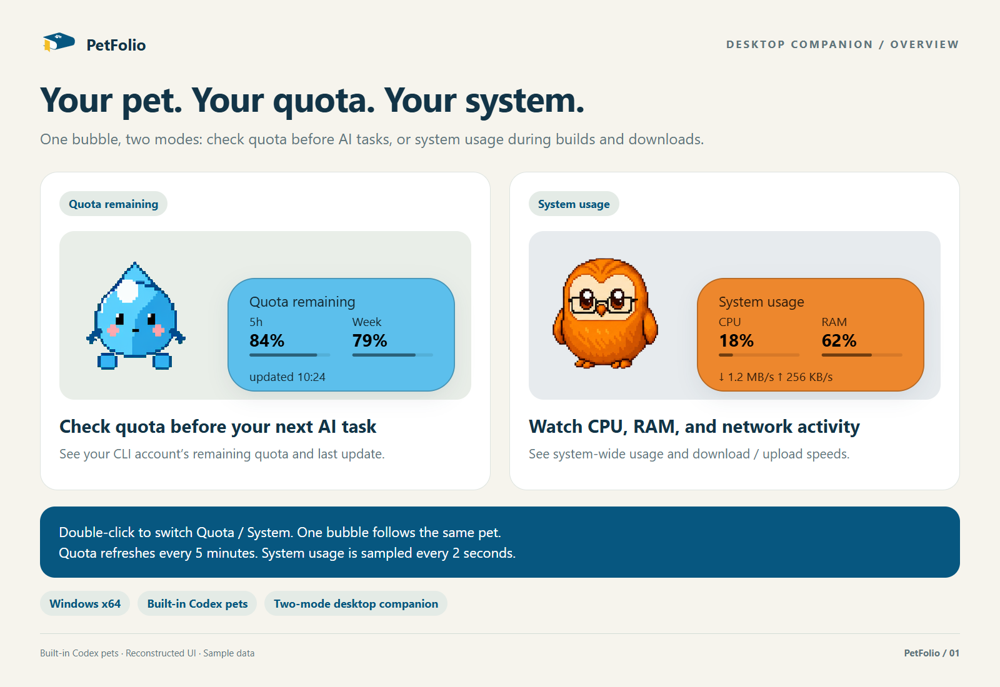

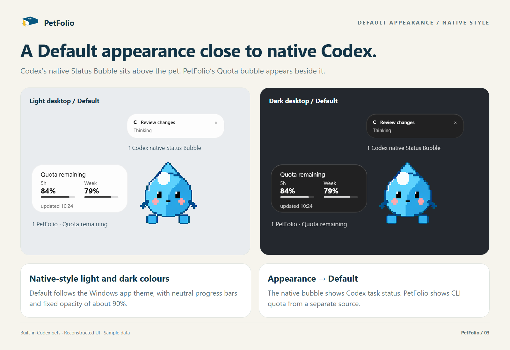

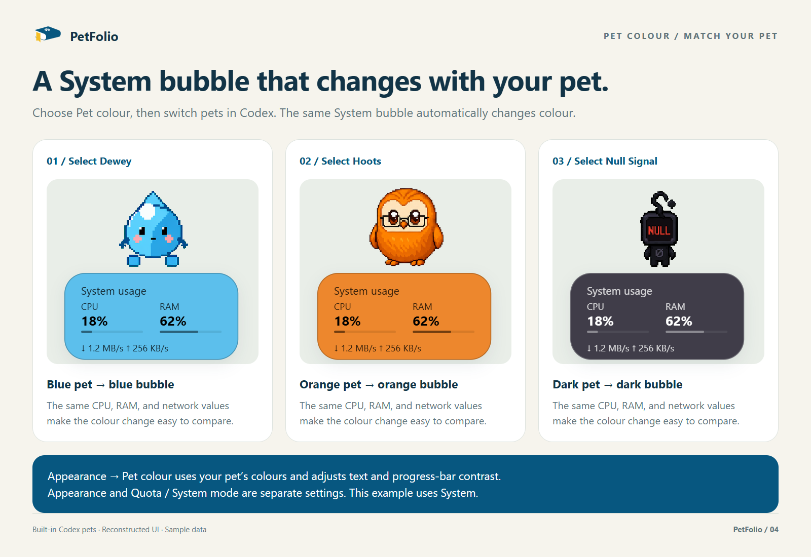

UI illustrations use built-in Codex pets and sample values.

<details>
<summary>Usage and settings guide (expand)</summary>

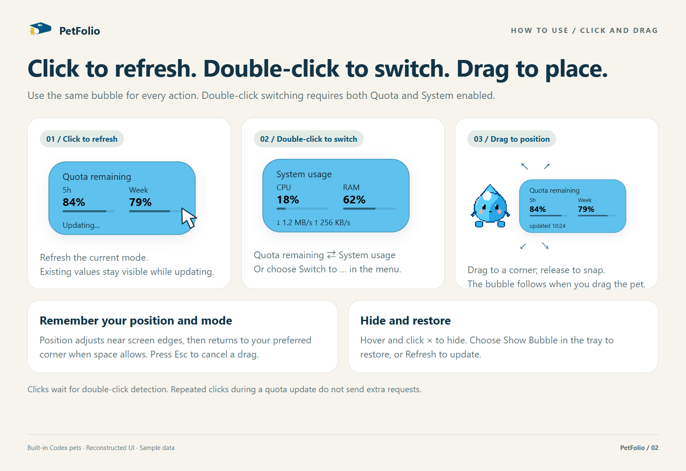

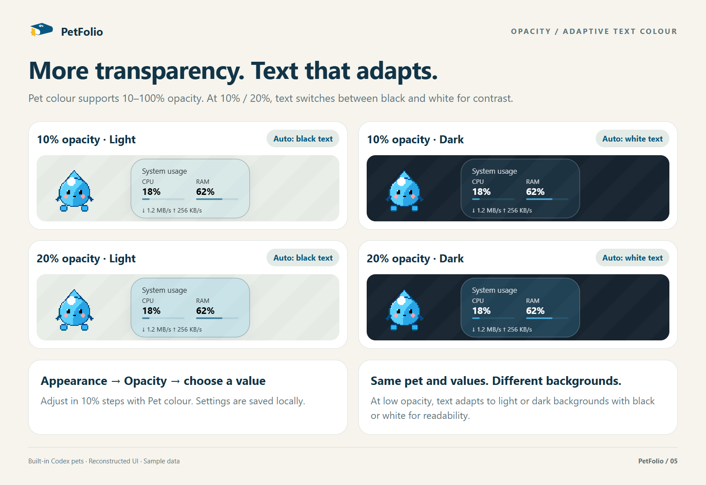

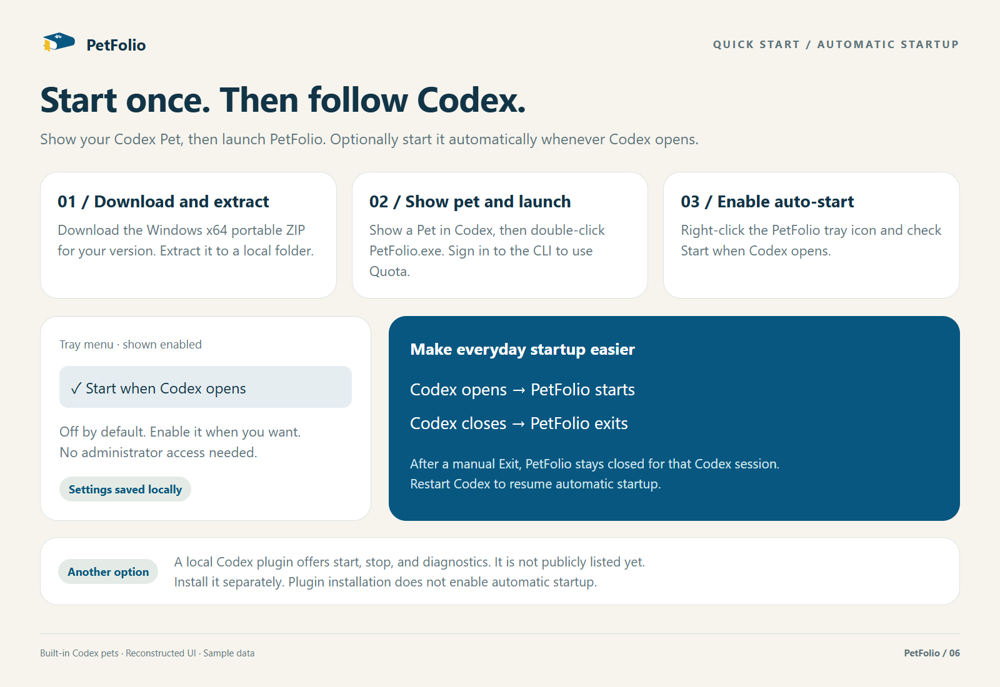

</details>

### Current features: Quota remaining and System Usage

Both modes share a **208 × 104 px** bubble titled **Quota remaining / System usage**. Typography uses Segoe UI: 13px titles, 16px bold metrics and 11px supporting text. Progress bars show quota remaining or CPU/RAM usage; Default uses neutral progress bars; Pet colour uses contrast-corrected pet colours. Both use approximately 85% fill / 15% track alpha. System displays download/upload rates with full units in the footer, for example `↓ 1.2 MB/s  ↑ 256 KB/s`, without a timestamp. Quota retains its `updated` footer.

- **System Usage**: Double-click the existing bubble to switch between quota and system metrics, or use **Switch to System usage / Switch to Quota remaining** in the tray menu. The mode is saved. System mode updates whole-system CPU usage, physical memory usage, and download (↓) / upload (↑) rates every two seconds. Single-click refreshes the current mode; dragging and closing work as before.
- Both modes share the same window, size, colour and placement. System sampling stops when hidden or switched to quota; quota polling continues on its original schedule. CPU and network rates initially show `--` until a second sample arrives. Traffic totals include active non-loopback, non-tunnel interfaces; VPN and virtual adapters may count traffic twice. These are system totals, not Codex-only traffic. Single-click waits for the OS double-click interval to avoid querying quota when switching modes.

- **Quota remaining:** Uses the Codex CLI `account/rateLimits/read` response to display remaining percentages for the returned usage windows. Purchased credits are kept separate from subscription quota.
- **Automatic and manual refresh:** Queries immediately when enabled and every five minutes afterward. Click the bubble to refresh. Existing values remain visible during updates and after failures, with a failure indicator when appropriate.
- **Following and placement:** While dragging the pet, compares its canvas center with the current monitor's work-area center: the bubble goes right when the pet is in the left half, and left upon reaching the right half. It stays vertically centered on the pet canvas. Idle layout favors the existing side, uses overflow scoring when space is limited, and constrains the result to the work area. Dragging the bubble still selects a side manually; the next pet drag selects again by the midpoint. Older corner preferences retain their left or right side as the initial direction.
- **Colors and glass background:** Default uses native bubble colours. Pet colour prefers a valid palette cache derived from pet source images; otherwise attempts to sample the pet window. Both appearances support rounded corners and share the native Status Bubble shadow, with strength following the Codex theme; Pet colour provides background opacity from 0% to 100% in 1% increments. Falls back to a translucent background if glass initialization fails.
- **Less interference:** Does not take focus from your editor. Transparent corners, background, and shadow regions allow mouse input to pass through. The bubble hides when the pet is hidden or closed.
- **Independent feature controls:** Temporarily hide the bubble or enable quota and system modes independently. Feature switches, background opacity and preferred placement are saved locally.

Quota comes from the **CLI login account**. PetFolio currently does not verify that this account matches the Codex desktop account; check this yourself when using multiple accounts.

### Getting started

#### Codex plugin (local testing)

Download or clone this repository and open PowerShell in its root:

```powershell
.\package-plugin.ps1
codex plugin marketplace add '.\dist\petfolio-marketplace'
codex plugin add petfolio@petfolio-local
```

The first command builds the application and generates the plugin package and local marketplace. Installation uses the current `CODEX_HOME`; set it first if your Codex data uses a custom location. Restart Codex and ask to open, stop, or check PetFolio in a new chat. Installation does not automatically launch the companion. Keep `dist\petfolio-marketplace` as the plugin source. See [PLUGIN.md](PLUGIN.md) for isolated testing, updates, and removal.

#### Requirements

- Windows x64. The application depends on Windows Forms, Win32, and Windows Composition; macOS and Linux are not supported.
- Codex desktop installed, with a visible Pet enabled.
- A logged-in Codex CLI (`codex.exe`) that can return quota information. Quota queries require a working network connection.
- .NET Framework 4.8, normally included with Windows 10/11. Building from source additionally requires PowerShell and the compiler, assemblies, and Windows WinMetadata referenced by `build.ps1`.
- A writable user data directory at `%LOCALAPPDATA%\PetFolio`, or an absolute directory specified by `PETFOLIO_DATA_DIR`, for settings, snapshots, and diagnostic logs.

The source build uses C# compiler scripts, with no `.csproj` or NuGet restore step. Normal builds and application use do not require Python. Compatibility across Windows versions and installation layouts still needs wider validation.

#### Use a published portable release

Updates to source on `main` do not automatically update Releases. Build from source using the plugin steps above or the source steps below for the current plugin and startup fixes. Check the Release version and notes before downloading.

1. Open the [latest release](https://github.com/tenntsitinn/PetFolio/releases/latest) and download `PetFolio-VERSION-win-x64.zip` from **Assets**.
2. Extract it into a local folder. Open Codex and show your Pet. Older releases may store settings beside the executable and require that folder to be writable.
3. Double-click the extracted `PetFolio.exe`. You can create a desktop shortcut; the icon is embedded.

No compilation, Python, or launcher script is required. GitHub's automatic **Source code** archives contain source files; download the Windows package instead. Extract the ZIP before running the application. Choose **Exit** in the system tray to stop it.

If Codex cannot be found, the application displays a startup message. For custom installations, pass both paths from a terminal:

```powershell
.\PetFolio.exe 'C:\path\to\codex.exe' 'C:\path\to\.codex'
```

Compare the accompanying `.sha256` file with `Get-FileHash .\PetFolio-VERSION-win-x64.zip -Algorithm SHA256` to check download integrity. The executable currently has no digital signature.

#### Run from source

Open PowerShell in the project root:

```powershell
.\build.ps1
.\run.ps1
```

The build produces `PetFolio.exe`, embedding `assets/PetFolio.ico` for the executable and system tray. A **PetFolio** tray icon appears when the application starts. The quota bubble appears when a visible pet is successfully identified.

You can also double-click **Open PetFolio.vbs**. It hides the command window and builds the application if the executable is missing; this requires VBScript to be enabled. Launching again restores the bubble in the existing instance while respecting enabled modes. Rebuild with `build.ps1` after changing source files; the launcher does not rebuild an existing executable automatically.

#### Specify the CLI and desktop data directory

Desktop shortcuts should discover the CLI automatically instead of pinning a versioned directory under `OpenAI\Codex\bin`; Codex upgrades can remove that directory. Use `./create-desktop-shortcut.ps1` to create or update the desktop shortcut, optionally with `-DataDirectory 'C:\path\to\.codex'` to retain a custom desktop data directory without pinning the CLI.

The EXE also accepts independent `--data-directory` and `--codex-executable` options. Any omitted setting is discovered automatically. The original two positional arguments remain supported; `run.ps1` and plugin management scripts still use paired path parameters.

The executable first checks running `codex` processes whose executable paths are inside `OpenAI\Codex\bin`, then searches `%LOCALAPPDATA%\OpenAI\Codex\bin`, and finally checks `PATH`. `run.ps1` uses the same discovery code.

To override discovery, replace these placeholder paths with your own:

```powershell
.\run.ps1 -CodexExecutable 'C:\path\to\codex.exe' -DataDirectory 'C:\path\to\.codex'
```

Provide both script parameters together. `-DataDirectory` points to the **desktop data directory** containing `.codex-global-state.json` and `config.toml`. Automatic discovery checks `CODEX_HOME` before `%USERPROFILE%\.codex`, using the presence of `.codex-global-state.json` to identify desktop data.

**The data-directory argument only controls where pet state is read. It does not set the CLI subprocess's `CODEX_HOME` or switch its login account.** The subprocess inherits the launch environment.

#### Stop

Choose **Exit** in the system tray, or run:

```powershell
.\PetFolio.exe --stop
```

PetFolio does not register Windows startup by default. You can enable the Windows option below from the tray menu.

### Using the application

#### Start when Codex opens (Windows)

Check **Start when Codex opens** in the tray menu to opt in (off by default).
This registers a per-user Windows login entry for a lightweight watcher, polling
every two seconds. It matches the Codex desktop process with a main window and
the OpenAI.Codex installation path, never the quota CLI. When Codex closes, the
companion exits and quota queries stop; the watcher waits for the next launch.
Manual Exit or `--stop` suppresses automatic relaunch for that Codex session.
Unchecking removes the login entry and stops the watcher on its next poll.

The watcher uses an independent EXE copy in the PetFolio data directory, with
desktop and optional CLI `CODEX_HOME` paths in `codex-autostart.json`; credentials
are not copied. Toggle off/on after an update to refresh the copy. Uncheck before
plugin uninstall, otherwise the independent copy remains enabled. No administrator
rights or Windows service are required. Windows Startup Apps may disable the entry.
Client renames, installation changes, and sessions without a desktop main window
still require compatibility testing. Plugin installation does not enable this option.

| Action | Result |
| --- | --- |
| Click inside the bubble | Refresh current data and text colour; repeated clicks during a quota query do not add requests |
| Double-click the bubble | Switch Quota / System when both features are enabled |
| Drag the bubble | Choose its position relative to the pet; it snaps into place with a spring animation |
| Press Esc while dragging | Cancel the drag |
| Tray: `Refresh` | Refresh the current mode's data and text colour |
| Tray: `Appearance → Default / Pet colour` | Default follows Codex light/dark mode, or Windows when Codex selects system, using native bubble colours and fixed approximately 90% opacity without background blur; Pet colour uses the pet palette and frosted glass |
| Tray: `Appearance → Opacity` | Adjustable only in Pet colour; the previous value is restored when switching back |
| Tray: `Appearance → Frosted glass` | Enable / disable background blur; disabled in Default; Pet colour remembers its choice |

| Hover and click the upper-left × | Hide the bubble while background refresh continues |
| Tray: `Show Bubble` | Restore the hidden bubble |
| Tray: `Features → Quota remaining / System usage` | Enable each mode independently; disabling Quota stops quota queries, disabling System stops system sampling |
| Tray: `Exit` | Close the application |

Mouse movement of at least 4 px counts as dragging. Dragging back to the starting point does not trigger a refresh. Canceling, losing mouse capture, releasing outside the rounded body, or clicking × also does not refresh.

During a query, the bubble displays `Updating...`. Successful queries show the update time. A failed query with previous data displays `Failed · last HH:mm`; an initial failure shows a retry prompt. Previously displayed values are not guaranteed to reflect current quota.

The tray menu and all submenus follow Codex's dark / light theme. When Codex selects system, they follow Windows app appearance without restarting.

Default Bubble also follows Codex's theme. It syncs at startup, each accepted quota query (automatically about every five minutes), and a click or tray Refresh. Missing, invalid or unreadable Codex theme settings retain the last Codex palette without independently selecting a Windows theme; quota failures do not prevent theme updates.

Hiding applies only to the current session. Both feature switches, the selected mode, background opacity and preferred placement are retained. Double-click and `Switch to …` are available only when both modes are enabled. Disabling the current mode selects the other enabled mode; enabling another mode preserves the current selection. At least one feature must remain enabled; clicking the last checked feature leaves it enabled.

Default uses native client text colours and follows the Codex theme, or Windows when Codex selects system. The following opacity and background-sampling rules apply only to Pet colour: percentage values use alpha 1; titles, metric labels, network rates and update time use the same RGB with alpha 0.8 (204/255) for visual depth. Background sampling occurs with the first quota query after startup, each accepted automatic or manual quota query, and applying a new opacity setting. At 0–20% background opacity (inclusive), System mode also samples with each two-second metrics refresh. Hidden bubbles skip sampling; movement, pet color updates, and ordinary repaint reuse the cached result. Blank bubble margins estimate the background without sampling text. Captures remain in memory and are not saved. Both light and dark pet colors at 0–20% opacity (inclusive) use plain black or white text according to background contrast, without a text outline. Failed captures retain the previous result; without a result, the original pet-based text colour is used.

### Local data and settings

PetFolio reads Codex pet settings and window state without modifying desktop settings or pet assets. Quota queries use a CLI app-server subprocess and do not launch model tasks. Drag tracking uses a mouse observation hook without intercepting or synthesizing user input.

These files are stored in `%LOCALAPPDATA%\PetFolio`, or an absolute directory specified by `PETFOLIO_DATA_DIR`. Application and plugin updates preserve this separate directory. First launch copies preferences and palette metadata from beside the executable if the destination files are absent. See [PLUGIN.md](PLUGIN.md) to migrate an older copy stored elsewhere. The file names are also excluded by [.gitignore](.gitignore):

| File | Contents |
| --- | --- |
| `appearance.json` | Background opacity, preferred placement and Quota / System mode |
| `pet-palettes.json` | Pet colors, IDs, source-image paths, and validity metadata |
| `quota-snapshot.json` | Latest successful quota snapshot |
| `probe-events.jsonl` | Diagnostic events for quota, pet changes, positioning, and errors |
| `probe-events.previous.jsonl` | The most recent rotated diagnostic log |
| `pet-diagnostic.json` | Last pet-discovery result, Windows/Codex versions, and display scaling |

Avoid sharing raw caches and logs containing personal paths, pet identifiers, or account usage data. New diagnostic logs are limited to 2 MiB each, retaining the current file and one previous file. Write failures do not interrupt bubble operations; logging retries after five seconds.

#### Optional: generate a pet palette cache

The application runs without a cache. Generating one prioritizes source-image colors rather than window sampling. This optional step requires Python, Pillow, and NumPy; normal application use does not.

Replace the installation and data paths below with your own:

```powershell
python -m pip install Pillow numpy
python .\build-pet-palettes.py --asar 'C:\path\to\resources\app.asar' --home 'C:\path\to\.codex'
```

The script reads built-in and custom sprite images and locally stored cloud migration mappings to create `pet-palettes.json` in the PetFolio data directory. Use `--output` for another absolute destination. The cache contains source paths, sizes, and modification times, rather than images. Regenerate it after client updates, source-image changes, or adding pets. It is reread when palette resolution is needed; entries with mismatched source metadata are not used.

### Development and extensibility

The project currently uses **explicit feature registration within a single process**:

| Layer | Main files | Responsibility |
| --- | --- | --- |
| Application host | `Program.cs`, `CompanionApplication.cs` | Single instance, message loop, tray, and feature registration |
| Startup discovery | `StartupConfiguration.cs` | Shared CLI and desktop-data discovery for EXE and script launches |
| Feature lifecycle | `ICompanionFeature.cs`, `QuotaFeature.cs`, `BubbleContentState.cs` | Feature lifecycle, modes and switches, refresh routing, and resource ownership |
| Preferences | `BubbleSettingsStore.cs` | Legacy settings, field validation, and atomic saves |
| System data | `SystemMetrics.cs`, `SystemMetricsService.cs` | OS counters, sampling lifecycle, and baseline resets on hide and restore |
| Shared pet state | `PetStateService.cs` | Window identification, position, visibility, and color state |
| Quota data | `QuotaData.cs`, `QuotaService.cs`, `CodexQuotaSource.cs` | Typed snapshots, refresh state, CLI protocol, and subprocesses |
| Quota window | `QuotaLabel.cs`, `CloseBubbleButton.cs` | Content, clicks, dragging, and close controls |
| Following and colors | `PetDragFollower.cs`, `PetPanelPlacement.cs`, `PetTheme.cs`, `PetColourSwitch.cs` | Positioning, snapping, sampling, and rejecting stale results |
| Platform effects | `Native.cs`, `GlassBackdrop.cs`, `BackdropGaussian.cs`, `ShadowBackdrop.cs` | Windows interop, glass, and shadows |

Implement `ICompanionFeature` for new features and register them in the host. Use the shared `IPetStateSource` for pet state instead of duplicating polling or mouse hooks. Features must support repeated start/stop cycles and clean up subscriptions, timers, and asynchronous work when stopped.

See [ARCHITECTURE.md](ARCHITECTURE.md) for data flow, resource ownership, and module conventions. Dynamic third-party plugin loading, a plugin SDK, and coordination between multiple panels are not implemented. Future features will extend the existing boundaries as needed.

#### Tests

Run from the project root:

```powershell
.\test.ps1
```

The script builds and runs startup discovery, colors, pet switching, drag following, placement, quota model/service/stdio protocol, preferences, system sampling, log rotation, pet diagnostics, feature lifecycle, and click-refresh tests in `.test-build`, then removes the generated test executables. Pull requests and pushes to `main` run Windows CI tests, an isolated build, and plugin payload checks.

Protocol tests use a local fake CLI without real accounts or network access. Some tests create independent verification windows; they do not operate the Codex client. Diagnostic logs may remain in the test directory. Use `./test.ps1 -CheckLocalPalettes` to additionally validate source metadata in the user data palette cache; stale sources fail this optional check.

To avoid overwriting a running executable, use a separate build directory:

```powershell
.\build.ps1 -OutputDirectory .test-build
```

For manual glass, hit-testing, and hide/restore verification:

```powershell
.\build-glass-verification.ps1 -OutputDirectory .test-build
.\.test-build\GlassVerification.exe
```

This tool briefly displays a test backdrop and writes screenshots to its output directory. It does not query real quota or change Codex settings. Automated tests do not replace checks of actual dragging, settings persistence after restart, mixed-DPI monitors, or compatibility after client updates.

#### Design and diagnostics

The quota panel is currently 208 × 104 px with 25 px rounded corners and a 12 px gap beside the pet. Upper and lower areas are reserved for the native Status Bubble and Action Bar. Pet following uses a 16 ms timer during dragging and 100 ms while idle. A separate interaction timer handles panel dragging/snapping at 16 ms and visible hover checks at 100 ms, stopping when hidden. These intervals are not frame-rate guarantees.

Tray **Diagnostics** explains missing pets and shows versions and display information. `PetFolio.exe --status` and plugin status scripts also return `diagnostics` while the companion is ready. The report updates on discovery-status changes or when opened manually; stopped status does not expose an earlier session's report. Unknown Codex package versions are shown as unavailable.

Run `./profile.ps1 -Seconds 8` to measure five isolated scenarios without querying real accounts or modifying Codex settings. It briefly displays verification windows and writes `.test-build/performance.json`. See [performance measurements](docs/PERFORMANCE.md) for methodology and the current baseline.

For repeated comparisons, run `./benchmark.ps1 -Seconds 30 -Warmup 10 -Rounds 5`. It freezes two builds and alternates their order. Native mouse input is replayed only with explicit `-NativeDrag`; the pointer moves during the run and is restored afterwards. `summarize-benchmark.py` validates and aggregates results using Python's standard library; Python is needed only for report analysis. See [five-pair measurements](docs/CONTROLLED_BENCHMARK.md) for methodology, limits, and data.

[design/](design/) contains selected assets. The [outline preview](design/quota-bubble-outline-preview.png) and its [SVG source](design/quota-bubble-outline-preview.svg) are design studies rather than screenshots of the current application; some text and layout are outdated. The application and tray use the embedded book, paw, and yellow-bookmark icon from the [PetFolio SVG](design/petfolio-symbol-v12.svg).

`Inspect.cs` and `inspect-windows.py` are read-only window diagnostic tools. They are unnecessary for normal use.

### Known limitations

- **Client internals:** Pet discovery, selection, and saved position rely on internal configuration keys, process details, and window characteristics that may change with Codex updates. Binding occurs only when a unique matching window is found.
- **Account matching:** The displayed quota belongs to the CLI account and may differ from the desktop account. It is not a real-time stream of individual usage events.
- **Windows compatibility:** Glass uses an internal host-backdrop interface. More Windows versions and mixed-DPI multi-monitor setups need testing.
- **Positioning:** PetFolio does not subscribe to native Status Bubble position events. Special snapping animations or layout changes may require adaptation.
- **Windows packages:** Portable ZIP and local Codex plugin packages are available. There is no Windows installer or automatic updater. Starting when Codex opens is optional and disabled by default. Exit before updating; the separate user data directory is preserved.

#### Maintaining versions and releases

`VERSION` is the version source. Keep both assembly versions in `Program.cs`, the identity version in `app.manifest`, and both manifests under `plugins/petfolio` synchronized. Commit descriptions begin with a three-part version, starting at `1.0.0`. Unless a new major version is explicitly requested, retain the first component; increment the second for larger changes or the third for smaller ones.

Run `./package.ps1` to create the portable ZIP and SHA256 file in `dist`. The archive contains the EXE, ICO, README, plugin guide, shortcut script, and VERSION, without local settings, quota data, or palette caches. Pushing a version tag matching `VERSION` runs GitHub Actions tests, builds the package, and publishes a Release. Update `RELEASE_NOTES.md` for subsequent releases.

Run `./package-plugin.ps1` for the plugin ZIP, checksum, and local marketplace. `./test-plugin.ps1` verifies installation with isolated Codex data; `-TestLaunch` also exercises companion startup and shutdown using a fake CLI. See [PLUGIN.md](PLUGIN.md) for scope and commands.

### Troubleshooting

| Problem | Check |
| --- | --- |
| Startup reports that the CLI cannot be found | Pass both paths to the EXE, or use `-CodexExecutable` and `-DataDirectory` with the script |
| Startup reports missing desktop data | Open a Pet in Codex and confirm the data directory contains `.codex-global-state.json` |
| Tray icon appears but there is no bubble | Confirm the pet is visible and the feature enabled, then choose `Show Bubble`; also check client compatibility and window discovery |
| Quota fails or differs from the desktop | Check the CLI account, launch environment, and connection, then click the bubble to retry |
| Compiler or reference assemblies are missing | Check Framework, GAC, and WinMetadata paths in `build.ps1`; discovery for alternative build layouts is not implemented |
| PowerShell blocks scripts | Follow your environment's execution policy and managed-device requirements |

When reporting issues, include Windows and Codex versions, reproduction steps, monitor setup, and display scaling. Share only relevant diagnostic excerpts with personal information removed.

### License and references

There is currently no `LICENSE` file; licensing terms are still to be decided.

- [Codex app-server](https://learn.chatgpt.com/docs/app-server): Quota-query protocol reference.
- [Windows Forms and Visual Layer](https://learn.microsoft.com/en-us/windows/uwp/composition/using-the-visual-layer-with-windows-forms): Windows Composition integration.
- [Direct2D Gaussian blur](https://learn.microsoft.com/en-us/windows/win32/direct2d/gaussian-blur): Backdrop blur reference.
- [Adaptive Tab Bar Colour](https://github.com/atbc-org/Adaptive-Tab-Bar-Colour/blob/main/src/utils/colour.ts): `PetTheme.cs` acknowledges inspiration from its separation of source color and contrast adjustment; color sampling is independently implemented.
